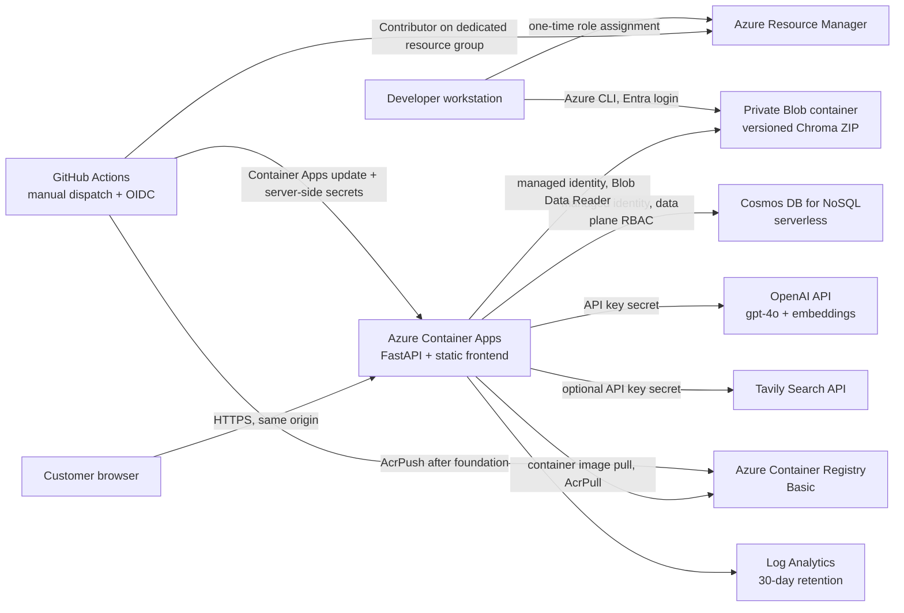

# Azure architecture and readiness

**Audit date:** 2026-10-13. This document describes the deployment path implemented in source. Resource provisioning and runtime readiness are specific to the target Azure subscription; use the latest workflow run and `/ready` response to verify a deployment.

## Audit summary

The repository contains a static HTML/CSS/JavaScript storefront and a FastAPI application (`backend/main.py`). The backend orchestrates a LangGraph assistant, OpenAI chat and embedding models, Chroma vector retrieval combined with in-memory BM25 using Reciprocal Rank Fusion, optional Tavily search, and owner-scoped account, order, and support workflows. Local account/order/support data is SQLite in `backend/koivu.sqlite3`; Chroma persists under `backend/chroma_db`; the product and policy corpus is versioned at `backend/data/products.txt`. The frontend originally sent API calls to fixed localhost URLs. It uses HttpOnly, SameSite=Strict session cookies and `credentials: include`.

The source includes a Docker image, Bicep foundation, manually dispatched deployment workflow, Cosmos DB adapter, and private Blob snapshot restore path. These artifacts do not provision resources on push. There is no operator audit table or seeded customer account; customers register through the demo. The catalog setup route can call the paid OpenAI embeddings API. Local Chroma and SQLite folders are ignored by Git and are not part of a deployment image.

The application remains a portfolio demo: checkout stores synthetic orders; an optional Stripe test-mode path can exercise hosted checkout locally, but the Azure workflow does not configure it. There is no live payment, inventory, fulfillment, or real support integration.

## Target deployment

The target serves the existing static site and API from **one Azure Container App origin**. This is intentional: a separate Static Web Apps hostname and Container Apps API hostname would make the current strict, credentialed cookies cross-origin, requiring additional domain/proxy/cookie decisions. Same-origin paths preserve the existing browser session model and need no production CORS allowlist.

The first, explicitly gated `foundation` run creates the registry, storage account/container, serverless database and containers, Log Analytics workspace, Container Apps environment, user-assigned identity, and a temporary Microsoft sample container with **internal-only ingress**. It is not publicly reachable. The separate `application` run builds the repository's Docker image on a GitHub-hosted runner, pushes it to ACR, writes provider keys as Container Apps secrets, replaces the sample image, switches ingress to public HTTPS on port 8000, deploys the app, and checks `/health` and `/ready`.

## Azure services

| Service | Purpose | Cost behavior / notes |
| --- | --- | --- |
| Azure Container Apps, Consumption | Run FastAPI and static frontend over HTTPS; one replica maximum and scale-to-zero | Free monthly grant currently includes 180,000 vCPU-seconds, 360,000 GiB-seconds, and 2 million external requests per subscription; usage beyond the grant is billed. A zero-replica app has no compute charge, but the first request has a cold start. |
| Azure Container Registry, Basic | Private storage for the application image | Fixed daily tier charge even when the app is idle; Basic includes 10 GB image storage. The GitHub identity receives `AcrPush`; the app identity receives `AcrPull`. |
| Azure Cosmos DB for NoSQL, serverless | Durable users/password hashes, session digests/expiry, demo orders, and support cases | No provisioned throughput minimum; requests (RUs) and stored data are billed. Intermittent demo traffic fits the model, but RU use is workload-dependent and there is no predictable-throughput guarantee. Serverless is single-region. **This is a paid architecture decision requiring the user's acceptance before provisioning.** |
| Azure Storage, Standard LRS | Private Blob container for the Chroma snapshot ZIP | Storage capacity, transactions, and any applicable network use are billed. The container is private, shared-key auth is disabled, and only the app's managed identity can read in runtime. |
| Log Analytics workspace | Container platform and application logs | Workspace is pay-as-you-go; ingestion above the applicable free amount can incur charges. Retention is set to 30 days. No Application Insights or custom metrics resource is added. |
| OpenAI and optional Tavily | Existing models and web search | Separate provider accounts and billing; OpenAI requests and embeddings can incur charges. Tavily is optional and used only on configured public-information routes. |

Azure free-trial credit is not the same as an always-free service quota. Trial credits expire; Azure may disable a trial subscription when the credit or trial term ends. Monthly service grants do not prevent overages. Azure Cost Management budget alerts notify but do not stop resources or billing. Check the [Azure pricing calculator](https://azure.microsoft.com/pricing/calculator/) for the selected subscription, region, and currency before creating the resources. Current official service details: [Container Apps billing](https://learn.microsoft.com/azure/container-apps/billing), [Cosmos DB serverless](https://learn.microsoft.com/azure/cosmos-db/serverless), [Cosmos cost planning](https://learn.microsoft.com/azure/cosmos-db/plan-manage-costs), [Container Registry pricing](https://azure.microsoft.com/pricing/details/container-registry/), [Blob Storage pricing](https://azure.microsoft.com/pricing/details/storage/blobs/), and [Azure Monitor pricing](https://azure.microsoft.com/pricing/details/monitor/).

### Illustrative monthly cost model, not a quote

- **Container Apps:** potentially $0 compute when scaled to zero and remaining inside current subscription grants; active cold starts and traffic consume the grant, then accrue usage charges.
- **ACR Basic:** approximately **$5 USD/month** at current public Microsoft example pricing, plus any storage over its included 10 GB or networking. It remains a recurring baseline while the registry exists. Verify in the calculator for the chosen region/offer.
- **Cosmos serverless:** Microsoft's current example rate gives **$5 for 20 million RUs** plus about **$0.25 per GB-month** storage. A very quiet project might use less; operator lists and support queries may consume more than point reads. This is an example, not a forecast.
- **Blob:** one small index archive is likely a small storage line, but there are also reads/writes; check the pricing calculator for the selected redundancy and region.
- **Logs:** the pricing page currently shows the first 5 GB/month per billing account free for the applicable pay-as-you-go Analytics Logs tier; data above the grant is charged. The 30-day retention setting avoids intentionally keeping old logs beyond that window.
- **AI:** OpenAI/Tavily bills are outside this Azure estimate and depend on prompts, embedding runs, model pricing, and provider plans.

An illustrative low-use baseline is therefore roughly **$5/month plus Cosmos request/storage use, Blob and log overages, active Container Apps usage over grants, and external AI charges**. It is not a guarantee of a ceiling. Set a budget and inspect actual cost daily after deployment.

## Persistence and data flow

| Data | Local development | Azure target |
| --- | --- | --- |
| Email, salted PBKDF2 password hash | SQLite `users` | Cosmos `users`, partition `/email`; document ID is normalized email so normalized duplicate email is rejected by the same partition. |
| Session token digest and expiry | SQLite `sessions`; browser gets opaque HttpOnly cookie | Cosmos `sessions`, partition `/token_hash`, with per-item TTL and explicit expiry check. The raw cookie is never persisted. |
| Demo orders, owner, lines, total | SQLite `orders` | Cosmos `orders`, partition `/user_id`; point operations always use the authenticated user ID. |
| Support questions, safe context, status and response | SQLite `support_cases` | Cosmos `support_cases`, partition `/user_id`; customer APIs remain owner-scoped. The shared support key is not per-person identity and there is no operator audit trail today. |
| Product source/policy corpus | `backend/data/products.txt` in Git | Same static file in the image; it remains the provenance source for catalog re-builds. |
| Chroma vectors and metadata | Local `backend/chroma_db` | Private versioned ZIP in Blob Storage, downloaded to the container's ephemeral `/tmp/koivu/chroma_db` at startup. BM25 is reconstructed in process from Chroma documents. The app never writes the production snapshot. |
| Cart and favourites | Browser `localStorage` | Browser `localStorage`; not server account data. |
| Operator identity/audit records | Not implemented | Not implemented; this design does not claim an audit history or per-operator accounts. |

The cloud database starts empty. No local SQLite accounts/orders/cases are migrated. Do not put real personal data in this demo. `backend/core/cosmos_database.py` implements the existing persistence method contract. Infrastructure creates the Cosmos containers; app startup only verifies them and fails closed if they are missing or unreachable. Managed identity plus Cosmos DB native data-plane RBAC is used; account key auth is disabled.

SQLite will remain the local backend. It is not mounted to Azure Files: SQLite warns that network filesystem locking/sync guarantees vary and can lead to corruption ([SQLite network filesystem guidance](https://www.sqlite.org/useovernet.html)).

### Chroma snapshot initialization/update

1. From local development, set `OPENAI_API_KEY` and `CATALOG_SETUP_API_KEY` in the ignored backend `.env`, run the app and authorized local `POST /setup` once if the index is empty. This one-time embedding call can cost money. Do not send the key in chat or commit it.
2. Stop the API so Chroma has closed its SQLite/HNSW files.
3. Run `python scripts/build_rag_snapshot.py --output ../.rag-snapshots/index-YYYYMMDD.zip` from `backend/`. The script creates a manifest with per-file SHA-256 hashes; it does not call OpenAI.
4. Upload under a unique blob name, for example `index-YYYYMMDD.zip`, using Entra-authenticated Azure CLI (`--auth-mode login`), never a SAS token or account key.
5. Set GitHub environment variable `RAG_INDEX_BLOB_NAME` to that exact blob name and dispatch the application workflow. The app checks the archive paths and hashes before extraction and verifies that it contains `chroma.sqlite3` and at least one catalog document.

Later catalog updates use a new blob name. Existing ZIPs are the rollback artifacts until manually deleted. The app's `/setup` endpoint is disabled in production to prevent index drift and surprise embedding costs.

## HTTPS, sessions, CORS and frontend

- Once the application stage runs, Azure Container Apps public ingress terminates HTTPS and rejects insecure ingress according to the `allowInsecure: false` configuration. Foundation-stage ingress is internal-only.
- FastAPI serves `frontend/` and APIs under the same host. `frontend/app-config.js` leaves `apiBaseUrl` empty for same-origin hosting; local static preview preserves the existing `?apiPort=` behavior.
- Session cookies remain opaque, `HttpOnly`, `SameSite=Strict`, path `/`, and `Secure` in production. `COOKIE_SECURE=true` is explicit. The backend does not trust arbitrary `X-Forwarded-*` headers; Uvicorn proxy-header processing is disabled because app logic does not need the forwarded scheme.
- Production CORS origins are empty by default because no cross-origin API call is needed. If a future frontend is moved to another origin, first design a same-site/custom-domain proxy and cookie strategy; do not silently switch to localStorage tokens.
- Static `apiBaseUrl` is public configuration, never a place for provider or support keys.

## Identity and secret handling

- GitHub Actions logs in using a Microsoft Entra federated credential (GitHub OIDC), not a client secret. The deploy identity gets `Contributor` on the dedicated app resource group plus `AcrPush` on the dedicated registry. It does not receive subscription-wide access.
- One user-assigned runtime identity is attached to Container Apps. A human operator assigns it only `AcrPull` on ACR, `Storage Blob Data Reader` on the storage account, and Cosmos DB built-in data contributor on the Cosmos account (documented in the Finnish guide). The Cosmos role is a Cosmos native data-plane role, separate from Azure management-plane `Contributor`.
- GitHub environment secrets `OPENAI_API_KEY` and `SUPPORT_AGENT_API_KEY` (plus optional `TAVILY_API_KEY`) are applied by the manually dispatched workflow as Container Apps secrets. Container environment variables refer to `secretref` names. None is a Bicep parameter/output or frontend variable. No Key Vault was added; it would add another resource and onboarding step without solving a requirement that Container Apps secrets do not already address here.
- Logs omit chat/prompt/response text and credentials. Provider model calls have an explicit 30-second timeout and one retry. The existing shared support key, account self-registration, lack of abuse throttling, missing retention automation, and missing operator audit attribution remain demo limitations.

## CI/CD and release safety

The repository-root `.github/workflows/newslens-ci.yml` is NewsLens CI. Koivu's project-local `.github/workflows/ci.yml` is not loaded by GitHub from this nested path; Koivu's deterministic tests and syntax checks run in the repository-root `../.github/workflows/azure-deploy.yml` before Azure login. That workflow has **only** `workflow_dispatch`, a `foundation` versus `application` selector, and a second confirmation choice that defaults to `no`. The GitHub `azure-deployment` environment can require a reviewer before it exposes secrets. A push cannot create Azure resources or deploy. Foundation provisioning and app deployment are separate runs. Rollback uses a prior immutable image SHA and a previous catalog blob name.

## Known limitations / approval boundary

1. Cosmos serverless is the selected option, but it is paid by RU and storage. Decide that its variable billing is acceptable and choose a monthly budget before provisioning. Bicep describes the resources; only a manual `foundation` dispatch provisions them.
2. The ACR Basic registry adds a nonzero recurring baseline while it exists. For an occasional portfolio deployment, deleting the resource group after the demo is the strongest cost stop.
3. Current app code is not a production commerce service: there is no email verification, password reset, per-operator authentication/audit, rate limiter, real payments, inventory, staff workflow, or data-retention job.
4. Container Apps starts from zero and the first request waits for Python, Cosmos, Blob, and Chroma startup. Each application dispatch checks liveness and readiness; review those results for the selected revision.
5. Chroma must be built locally and uploaded separately. Azure does not automatically create embeddings. A missing/invalid blob or wrong storage role keeps the app unready.
6. Deterministic tests and syntax checks do not prove live Cosmos, Blob, provider, or browser behavior. The gated workflow compiles Bicep during the foundation stage and checks application health/readiness during the application stage.

See [deployment operations](DEPLOYMENT.md) and the [deployment checklist](CHECKLIST.md).
